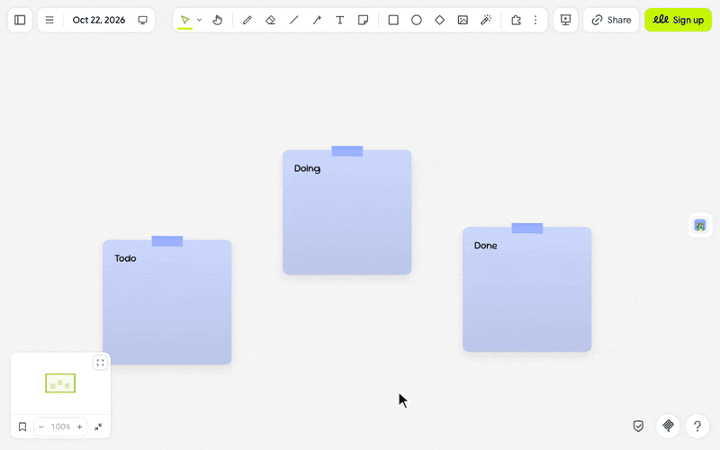

# Diny Pet ヽ(°〇°)ﾉ

**a little dino that lives on your board.**

Diny, Drawdy's mascot, is a green dinosaur in a viking helmet with a sword. Turn it on and Diny keeps you company, hopping from shape to shape, riding along when you pan and shouting when you click it ♡

---

## let's hop ٩(◕‿◕)۶

1. Click the **green dino** in the extension rail. Diny drops in from the top of your board.
2. Watch it land on a shape or at the bottom of the board and wave hello. Every few seconds it hops to a shape nearby or along the bottom, facing the way it goes, then stands there gaping. It keeps to the board and never wanders under the sidebar.
3. Click Diny and it shouts. Click it mid-hop and it shouts as it lands.
4. Grab Diny and drag it anywhere on the board. It dangles while you hold it, then drops onto whatever is below when you let go.
5. After a good run of hopping Diny gets tired and naps for half a minute. Click it to wake it up.
6. Click the **green dino** again to send Diny away. Until you do, Diny comes back whenever you open a board.

> (・_・;) **can others see Diny?** No, only you. Diny lives on your screen, and your board stays exactly as it was.

---

## make it yours (｡•̀ᴗ-)✧

- **Shapes to stand on**: Diny stands on what you drew, not the box around it: along a pencil stroke or a line, over the top of a circle or a diamond, on the upper edge of a rotated shape. It lands only where the outline is gentle enough to stand on, and skips frames and anything narrower than about 60 px on screen.
- **Pan and zoom**: Diny rides along on its shape and stays the same size on screen.
- **Delete its shape**: Diny drops straight down to the shape below or the bottom of the screen.
- **Move away**: when its spot leaves the view, Diny drops back in from the top.
- **On or off**: one click on the **green dino**, remembered in this browser.

---

## little things to try (っ˘ω˘ς )

- Line up a row of sticky notes and watch Diny hop along them.
- Pan slowly across the board and let Diny surf on its shape.
- Delete the shape under Diny in the middle of a retro for a quick laugh.
- Pick Diny up and drop it onto the shape you want everyone to look at.
- Keep Diny on while you share your screen in a workshop: everyone watching sees it, and nobody's board changes.

---

**the small print**: nothing downloads, Diny comes with the extension; nothing you draw or type leaves your board. Diny reads where the shapes in your view are, inside your browser, so it knows where to stand. Whether Diny is on is saved in this browser. Diny's artwork is Drawdy's and is not covered by the MIT licence. Code [MIT](https://github.com/mickyngub/drawdy-diny-pet/blob/main/LICENSE); building it yourself? See [DEVELOPMENT.md](https://github.com/mickyngub/drawdy-diny-pet/blob/main/DEVELOPMENT.md).
